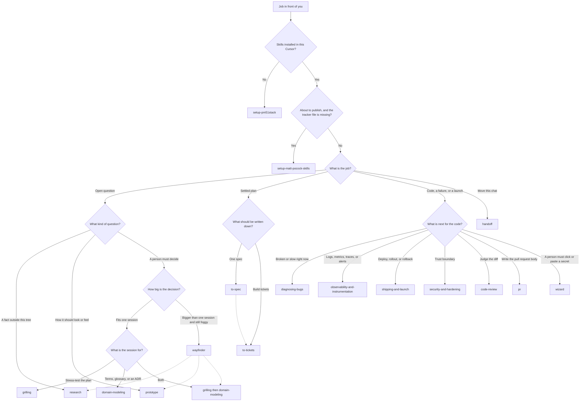

# When to use a pm51stack skill

The walk below is the decision graph for the 16 skills `setup-pm51stack` installs, plus the setup skill itself. Use the table to look up a skill. Use the chart to pick one from the job in front of you.

| Skill | Who invokes it | Use it when |
| --- | --- | --- |
| `setup-pm51stack` | You type it | The Matt Pocock and Addy Osmani packs are not installed in this Cursor yet |
| `setup-matt-pocock-skills` | You type it | This repo still has no `docs/agents/issue-tracker.md`, and you are about to publish a spec, tickets, or a map |
| `wayfinder` | You type it | The work is bigger than one session and the destination is still foggy |
| `grilling` | You or the agent | Stress-test a plan or decision that fits one session |
| `domain-modeling` | You or the agent | Sharpen terms, edit `GLOSSARY.md`, or record an ADR |
| `to-spec` | You type it | The conversation is settled and you want it published as a spec, with no further interview |
| `to-tickets` | You type it | Break a plan or spec into tracer-bullet tickets that name what blocks them |
| `research` | You or the agent | You need a cited fact from primary sources outside this working tree |
| `prototype` | You or the agent | A throwaway check of logic, state, or UI will answer the question |
| `diagnosing-bugs` | You or the agent | Something is broken, throwing, failing, or slow right now |
| `observability-and-instrumentation` | You or the agent | Add logs, metrics, traces, or alerts, or a past incident could not be seen from the data |
| `shipping-and-launch` | You or the agent | Prepare a deploy, staged rollout, or rollback |
| `security-and-hardening` | You or the agent | The change crosses a trust boundary: untrusted input, auth, sessions, secrets, a new package, or personal data |
| `code-review` | You or the agent | Judge the diff since a commit, branch, tag, or merge-base |
| `pr` | You or the agent | Write the pull request body |
| `wizard` | You or the agent | A person must click a dashboard, paste a secret, or run a cutover |
| `handoff` | You type it | This conversation has to continue in a fresh agent |

`security-and-hardening` also runs beside the skill you land on when that change crosses a trust boundary.

